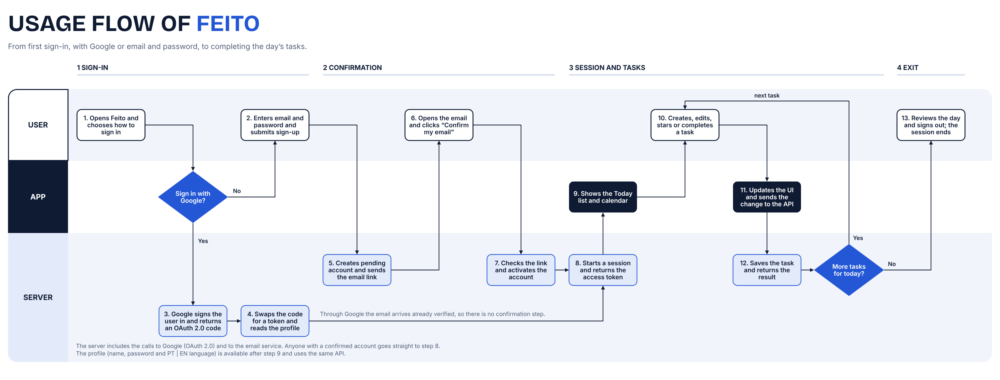

# Feito

<div align="left">

[]()
[]()
[](LICENSE)

</div>

> **Feito** is a full-stack to-do list application with email-confirmed accounts, Google sign-in, custom lists, smart views, and a monthly calendar. Built as a monorepo with FastAPI and React, in Portuguese and English.

<details>
<summary><strong>Table of Contents</strong></summary>

- [About](#about)
- [Features](#features)
- [Usage Flow](#usage-flow)
- [Tech Stack](#tech-stack)
- [Architecture & Design Decisions](#architecture--design-decisions)
- [Getting Started](#getting-started)
- [Author](#author)
- [License](#license)

</details>

---

## About

Feito is a study project built end to end, from the database to the interface, with the goal of practicing a real-world stack: secure authentication, a typed REST API, automated tests, and a responsive React front end.

> The project is in its very first stage. The `api/` folder holds only the Poetry setup (dependencies and a bare FastAPI app), and `web/` is still empty. Everything below describes the **planned scope**. This README will be updated as each part is built.

---

## Features

Planned, none of these is implemented yet.

| Capability | Description |
|---|---|
| **Authentication** | Email and password sign-up with email confirmation, plus Google OAuth 2.0 (state and PKCE) |
| **Sessions** | Short-lived JWT access token with a refresh token in an `httpOnly` cookie |
| **Lists** | Custom lists, with default lists created for every new account |
| **Tasks** | Create, edit, complete, and favorite tasks |
| **Smart Views** | Filtered views such as important and completed tasks, with sidebar counters |
| **Calendar** | Monthly calendar highlighting the days that have tasks |
| **Profile** | Edit profile, change password, and delete account |
| **i18n** | Interface available in Portuguese and English |

---

## Usage Flow

From the first sign-in, with Google or email and password, to completing the day's tasks.



1. **Sign-in:** the user chooses Google or email and password.
2. **Confirmation:** with email and password, the server creates a pending account and emails a confirmation link; opening it activates the account. With Google the email arrives already verified, so this step is skipped.
3. **Session and tasks:** the server starts a session and returns an access token, the app shows the Today list and the calendar, and every change to a task is saved through the API.
4. **Exit:** the user reviews the day and signs out, which ends the session.

---

## Tech Stack

| Tool | Purpose |
|---|---|
| [Python](https://python.org) | Back end language (3.12) |
| [Poetry](https://python-poetry.org) | Back end dependency management |
| [FastAPI](https://fastapi.tiangolo.com) | REST API framework |
| [PostgreSQL](https://postgresql.org) | Database |
| [SQLAlchemy 2](https://www.sqlalchemy.org) | ORM |
| [Alembic](https://alembic.sqlalchemy.org) | Database migrations |
| [Authlib](https://authlib.org) | Google OAuth 2.0 |
| [Pytest](https://pytest.org), [Ruff](https://docs.astral.sh/ruff/), [mypy](https://mypy-lang.org) | Tests, linting, and type checking |
| [React](https://react.dev) | Front end library |
| [Vite](https://vite.dev) | Front end build tool |
| [TypeScript](https://www.typescriptlang.org) | Front end language |
| [Docker Compose](https://docs.docker.com/compose/) | Local PostgreSQL and Mailpit |

---

## Architecture & Design Decisions

```
feito-product/
├── api/                    # FastAPI back end
│   ├── app/                # Application package (main.py)
│   └── pyproject.toml      # Poetry project and dependencies
├── web/                    # React + Vite + TypeScript front end (planned)
├── docs/                   # Diagrams (usage flow)
├── .gitignore
├── LICENSE
└── README.md
```

The decisions below are the plan for the stack, not yet reflected in code:

- **Monorepo:** `api/` and `web/` live in the same repository, so a change that touches both ships in a single commit.
- **Sessions:** a short-lived JWT access token plus a refresh token stored in an `httpOnly` cookie, which keeps the refresh token out of reach of JavaScript.
- **Password hashing:** Argon2.
- **Email:** SMTP, with Mailpit as the local inbox during development.
- **Local environment:** PostgreSQL and Mailpit run through Docker Compose.

---

## Getting Started

Only the API skeleton can be run so far. The web app and the Docker Compose setup are still to come.

**Requirements:** Python 3.12 and [Poetry](https://python-poetry.org).

```bash
# Clone the repository
git clone https://github.com/Hugolelis/feito-product.git
cd feito-product/api

# Install dependencies (creates api/.venv)
poetry install

# Run the API
poetry run uvicorn app.main:app --reload
```

The API runs at `http://localhost:8000`, with interactive docs at `/docs`.

---

## Author

[Hugolelis](https://github.com/Hugolelis)

---

## License

Distributed under the **MIT License**. See [LICENSE](LICENSE) for more information.
